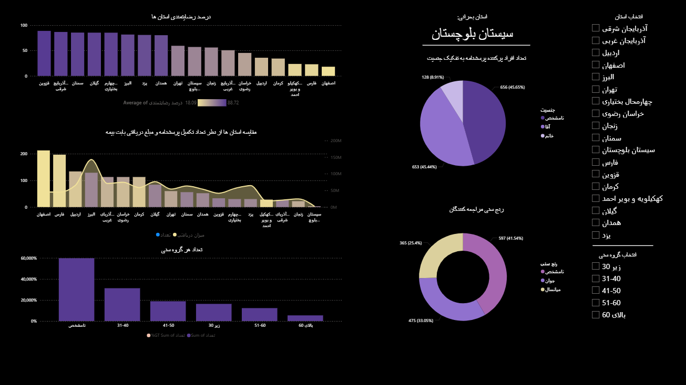
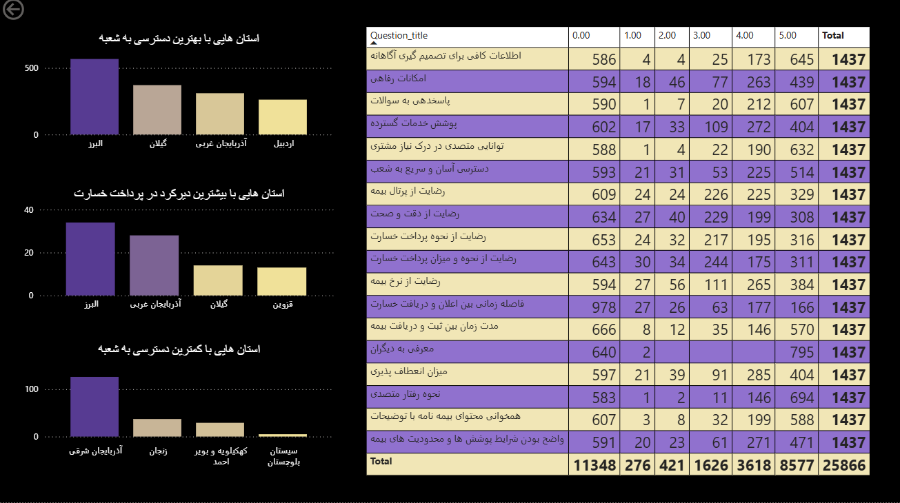
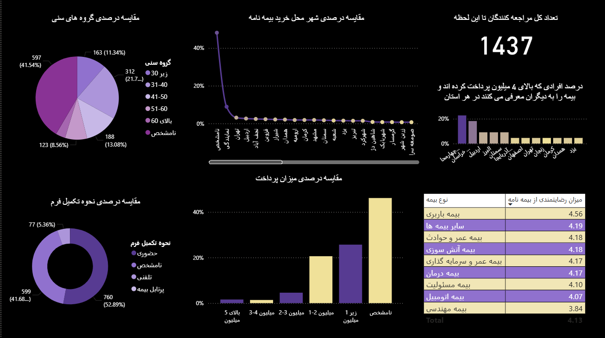
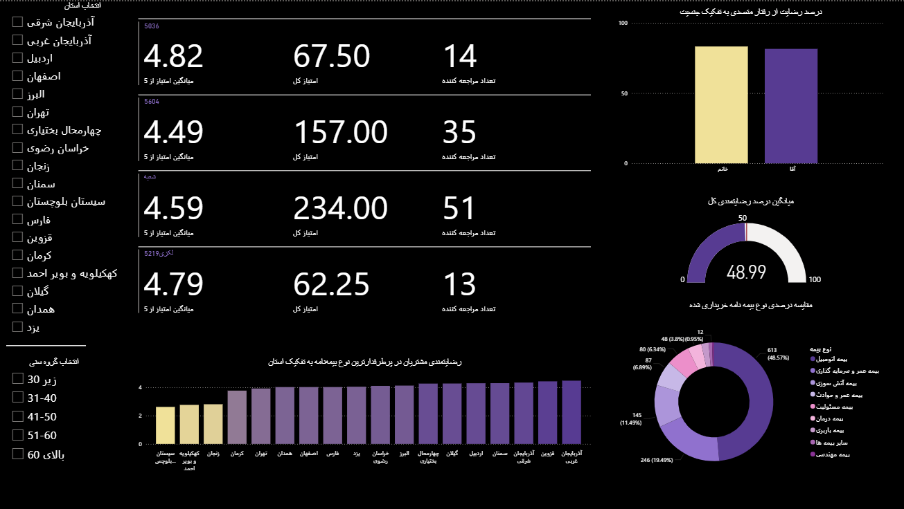
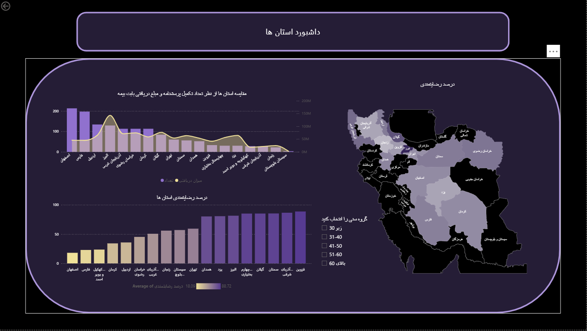

# Insurance Customer Satisfaction Analytics | Power BI

## Project Overview

This project presents an interactive Power BI dashboard for analyzing customer satisfaction, insurance-related indicators, and regional differences in the insurance sector.

The dashboard was independently designed and developed as part of a 30-hour Power BI training course at Tehran Institute of Technology, using a synthetic educational dataset provided by the course instructor.

The project demonstrates how interactive data visualizations can support exploratory analysis and comparisons across insurance providers, customer groups, branches, and geographic regions.

## Dashboard Features

- **Customer Satisfaction Analysis:** Explore customer satisfaction scores and compare results across insurance providers.
- **Customer Demographics:** Analyze age groups, insurance categories, and payment-related indicators.
- **Branch and Regional Rankings:** Compare performance indicators and survey results across branches and provinces.
- **Provincial Analysis:** Examine differences in customer-related indicators across Iranian provinces.
- **Geographic Visualization:** Explore regional patterns through an interactive map of Iran.
- **Interactive Filtering:** Filter and compare different segments of the dataset.

## Dashboard Screenshots

### 1. Customer Satisfaction

### 2. Customer Demographics

### 3. Branch and Regional Rankings

### 4. Provincial Analysis

### 5. Geographic Dashboard

## Tools and Skills

- Microsoft Power BI Desktop
- Interactive dashboard design
- Data visualization and exploratory analysis
- Comparative reporting
- Geographic data visualization
- Data filtering and segmentation

## Project Files

This repository includes:

- The original Power BI dashboard file (`.pbix`)
- Five screenshots illustrating the dashboard pages
- This README documentation

To explore the interactive report, download the `.pbix` file and open it using Microsoft Power BI Desktop.

**Language note:** The dashboard interface and several data labels are in Persian.

## Data Disclaimer

**This project uses synthetic data provided by the course instructor exclusively for educational purposes.**

The customer records, satisfaction scores, financial indicators, and other reported figures do not represent actual insurance company or customer information.

The dashboard design, visualizations, and report development were completed independently by the author as part of the training course.

## Author

**Maral Esmikhani**  
B.Sc. Student in Industrial Engineering  
Shahid Beheshti University, Tehran, Iran

[GitHub Profile](https://github.com/MaralSmi)
